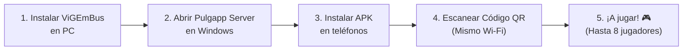
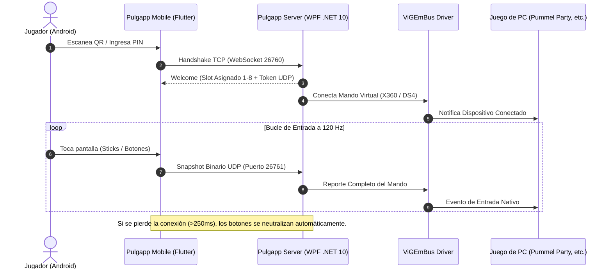

# 🎮 Pulgapp

<div align="center">

**Transforma tus teléfonos móviles en mandos virtuales de PC con latencia ultrabaja para juegos multijugador local.**

Juega a **Pummel Party**, emuladores, juegos de Steam y party games de hasta **8 jugadores** utilizando los teléfonos de tus amigos como controles, sin necesidad de comprar mandos físicos adicionales.

[](https://github.com/Leandro96JG/PulgApp/releases)
[](https://github.com/Leandro96JG/PulgApp)
[](https://dotnet.microsoft.com/)
[](https://flutter.dev/)
[](https://github.com/Leandro96JG/PulgApp)
[](LICENSE)

</div>

---

## 🚀 Descargas Directas (Downloads)

| Componente | Plataforma | Archivo | Enlace de Descarga |
|---|---|---|---|
| 📱 **Cliente Móvil** | Android 8.0+ | `Pulgapp-Android.apk` | [📥 **Descargar APK**](https://github.com/Leandro96JG/PulgApp/releases/latest) |
| 💻 **Servidor Host** | Windows 10 / 11 (x64) | `Pulgapp-Server-win-x64.zip` | [📥 **Descargar Servidor (.zip)**](https://github.com/Leandro96JG/PulgApp/releases/latest) |
| ⚙️ **Driver Requerido** | Windows | `ViGEmBus_Setup_1.22.0.exe` | [📥 **Descargar Driver ViGEmBus**](https://github.com/nefarius/ViGEmBus/releases/tag/v1.22.0) |

> [!IMPORTANT]
> **Prerrequisito Obligatorio en Windows:**  
> Para que Windows reconozca los mandos virtuales en los juegos, debes tener instalado el driver oficial **[ViGEmBus v1.22.0](https://github.com/nefarius/ViGEmBus/releases/tag/v1.22.0)** en tu PC antes de iniciar el servidor.

---

## ⚡ Inicio Rápido en 3 Minutos



1. **Instala el driver en tu PC**: Ejecuta el instalador de [ViGEmBus](https://github.com/nefarius/ViGEmBus/releases/tag/v1.22.0) (solo se hace una vez).
2. **Inicia el servidor en Windows**: Descomprime `Pulgapp-Server-win-x64.zip` y abre `Pulgapp.Server.App.exe`.
3. **Instala la app en los teléfonos**: Pasa el archivo `Pulgapp-Android.apk` a los dispositivos e instálalo (asegúrate de que los teléfonos estén conectados a la misma red Wi-Fi que la PC).
4. **Conéctate al instante**:
   - Abre la app y presiona **SCAN QR**.
   - Apunta la cámara al código QR que aparece en la pantalla del servidor de Windows.
   - *(Alternativamente, puedes ingresar la dirección IP y el PIN de 6 dígitos manualmente o presionar **FIND SERVER**)*.
5. **¡Listo!** Abre tu juego favorito en Windows y detectará el teléfono como un mando real conectado.

---

## ✨ Características Principales

### 👥 Soporte para hasta 8 Jugadores Locales
- **Slots 1 a 4**: Mandos virtuales **Xbox 360 / XInput** reconocidos por el 100% de los juegos de PC.
- **Slots 5 a 8**: Mandos virtuales **PlayStation DualShock 4** (DirectInput/Raw Input/SDL) para superar la limitación clásica de 4 dispositivos de XInput en juegos como *Pummel Party*.

### ⚡ Latencia Ultrabaja a 120 Hz (Sin Input Lag)
- **Protocolo Híbrido Optimizado**:
  - **WebSocket / TCP (Puerto 26760)**: Autenticación con PIN, handshake, negociación de ranuras y estado de lobby.
  - **UDP (Puerto 26761)**: Snapshots idempotentes de estado completo de 60 bytes enviados a **120 Hz**.
- **Descarte Inteligente**: Filtra paquetes desordenados o duplicados y neutraliza inmediatamente los controles ante pérdida de señal (máximo 250 ms) para **evitar botones atascados**.

### 📱 Controles Táctiles Diseñados para Jugar sin Mirar
- **Joysticks con Origen Flotante**: El centro del joystick se posiciona dinámicamente donde apoyas el pulgar.
- **D-Pad de 8 Direcciones Deslizable**: Diseñado para cambios de dirección continuos y precisos.
- **Gatillos Táctiles**: Modos analógico proporcional o digital instantáneo.
- **Estilos Visuales Personalizables**: Elige entre la botonera clásica de **Xbox** (`A`, `B`, `X`, `Y`) o **PlayStation 4** (`✕`, `○`, `□`, `△`).
- **Respuesta Háptica**: Vibración táctil nativa en cada pulsación para sentir los botones virtuales.
- **Pad de Pruebas Offline**: Prueba y calibra la sensibilidad de tus controles antes de conectarte a una partida.

### 🖥️ Experiencia de Escritorio en Windows
- **Interfaz Oscura Gaming**: Panel interactivo con vista en tiempo real de los 8 slots, contador de jugadores conectados y código QR dinámico.
- **Bandeja del Sistema (System Tray)**: Minimiza la aplicación a la barra de tareas para que no estorbe mientras juegas a pantalla completa.
- **Instancia Única**: Evita abrir el servidor dos veces por error.
- **Arranque Opcional**: Opción de inicio automático con Windows en segundo plano.

---

## 🏗️ Arquitectura del Sistema



---

## 🛠️ Para Desarrolladores (Compilación desde Código)

### Prerrequisitos
- **Windows**: [.NET 10 SDK](https://dotnet.microsoft.com/) y Visual Studio 2022 / VS Code.
- **Mobile**: [Flutter SDK](https://flutter.dev/) (Canal stable) y Android SDK con Java 17.
- **Driver**: [ViGEmBus 1.22.0](https://github.com/nefarius/ViGEmBus/releases/tag/v1.22.0) instalado localmente.

### Compilación y Tests en Windows
```powershell
# Restaurar dependencias
dotnet restore windows/Pulgapp.sln --force-evaluate

# Ejecutar las 65 pruebas automatizadas
dotnet test windows/Pulgapp.sln --configuration Release -p:Platform=x64

# Compilar servidor portable
dotnet publish windows/src/Pulgapp.Server.App/Pulgapp.Server.App.csproj --configuration Release -r win-x64 --self-contained true -o build/windows-publish
```

### Compilación y Tests en Mobile (Flutter)
```powershell
cd mobile

# Instalar dependencias
flutter pub get

# Ejecutar análisis estático y 66 pruebas automatizadas
flutter analyze --no-pub
flutter test --no-pub

# Compilar APK de Android
flutter build apk --debug --no-pub
```

### Script de Empaquetado Automático
Para generar tanto el `.zip` de Windows como el `.apk` de Android en la carpeta `release/` con un solo comando:
```powershell
.\tools\package-release.ps1
```

---

## 📄 Documentación Técnica

Para profundizar en el diseño y los estándares del proyecto:
- [protocol/protocol-v1.md](protocol/protocol-v1.md) — Especificación normativa del protocolo binario UDP y WebSocket.
- [docs/architecture.md](docs/architecture.md) — Arquitectura modular y responsabilidades de capas.
- [plan.md](plan.md) — Plan maestro de fases, tareas y evidencia de aceptación.
- [MEMORY.md](MEMORY.md) — Decisiones arquitectónicas (ADR) y lecciones aprendidas.

---

## ⚖️ Licencia

Distribuido bajo la Licencia MIT. Consulta `LICENSE` para más detalles.
